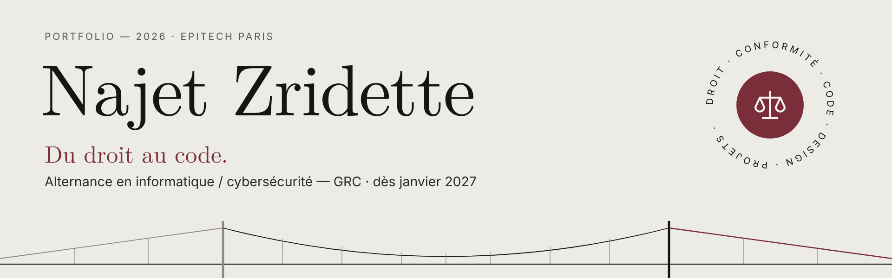

  

  
  
  
  

## Qui suis-je ?

Étudiante en **Master of Science à Epitech Paris** (actuellement en Pré-MSc, niveau Bac+3), après un parcours en **droit** à l'Université Paris II Panthéon-Assas.

Je me suis tournée vers la tech et la cybersécurité pour passer de la règle à son application concrète. La **GRC** (Gouvernance, Risques et Conformité) est pour moi le point de rencontre entre ces deux mondes.

- 🎯 Recherche d'une **alternance en informatique / cybersécurité (GRC)** à partir de **janvier 2027**
- 📍 Paris / Île-de-France
- 🗓️ Rythme : 4 semaines en entreprise / 2 semaines à l'école

## En ce moment

- 🎮 **Trip Trap** : un jeu en 2D en pixel art, en Java, en équipe de 3
- 🛡️ **Certifications en cours** : SecNumacadémie (ANSSI), L'atelier RGPD (CNIL), Foundations of GRC, Cisco Cybersecurity, Pix
- 📚 **Autoformation** : ISO/IEC 27001, EBIOS Risk Manager, RGPD, NIS2, PSSI, DORA

## Du droit au code

| Ce que le droit et le management m'ont appris | Ce que j'en fais en tech |
| --- | --- |
| Rédiger des actes juridiques précis | Documenter un projet : cahier des charges, UML, maquettes |
| Respecter des obligations légales | Me former à la conformité : RGPD, ISO 27001, NIS2 |
| Encadrer une équipe de 24 personnes | Piloter un projet en équipe : tâches, planning, suivi |
| Suivre un portefeuille clients | Concevoir pour l'utilisateur |

## Projets

| Projet | Description | Durée | Outils |
| --- | --- | --- | --- |
| [**tanière**](https://github.com/najetzridette/taniere) | Job board qui protège les candidats contre les fausses annonces. Direction artistique et web design. 🏆 **Meilleure présentation Job Board 2026** | 2 semaines · équipe de 3 | Figma, React, FastAPI, MySQL |
| **Trip Trap** | Jeu en 2D en pixel art, conçu en programmation orientée objet. *En cours* | 3 semaines · équipe de 3 | Java, LibGDX, UML, JUnit |
| [**Le Pendu**](https://github.com/najetzridette/pendu) | Mon premier jeu complet. [Jouable sur mon portfolio](https://najetzridette.github.io/#projets) | 3 jours · solo | Python |
| [**Portfolio**](https://github.com/najetzridette/najetzridette.github.io) | Mon portfolio en français, anglais et allemand | solo | HTML, CSS, JavaScript |

## Outils

**Langages** 

**Outils et méthodes** 

**Intelligence artificielle** 

**Langues** : français (langue maternelle) · arabe (courant) · allemand (baccalauréat section européenne) · anglais (scolaire, TOEIC en préparation)

## Me contacter

📧 [najetzridette@gmail.com](mailto:najetzridette@gmail.com) · 💼 [LinkedIn](https://www.linkedin.com/in/najet-zridette) · 🌐 [najetzridette.github.io](https://najetzridette.github.io)
